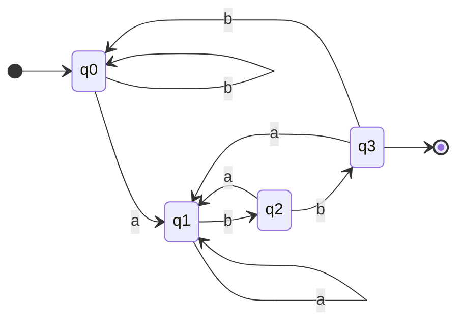

<p align="center">
  
</p>

# Autogex

**A lightweight, zero-dependency Java engine for processing Finite State Automata and Regular Expressions.**


[](https://sonarcloud.io/summary/new_code?id=Tugamer89_autogex)
[](https://sonarcloud.io/summary/new_code?id=Tugamer89_autogex)
[](https://sonarcloud.io/summary/new_code?id=Tugamer89_autogex)
[](https://sonarcloud.io/summary/new_code?id=Tugamer89_autogex)


[](https://autogex.eu.org)
[](https://central.sonatype.com/artifact/org.eu.autogex/autogex)
[](https://github.com/sponsors/Tugamer89)

**Autogex** is a clean, extensible Java 25 library built to model, convert, minimize, and visualize formal computational models. It strictly implements Formal Language Theory theorems through an immutable, thread-safe Fluent API (via the Builder Pattern) and full Java Platform Module System (JPMS) encapsulation.

## Quick Glance

Compile a regular expression into a minimal `DFA` and render its state diagram natively in Mermaid.js in a few lines of Java:

```java
import org.eu.autogex.export.MermaidExporter;
import org.eu.autogex.models.DFA;
import org.eu.autogex.regex.Regex;

DFA dfa = new Regex("(a|b)*abb").getAutomaton();
String mermaid = MermaidExporter.toMermaid(dfa);
```



## Key Features

- **Regex Compilation Pipeline:** Converts string regular expressions into minimal DFAs via Abstract Syntax Trees (`RegexNode`) and Thompson's Construction (`ThompsonConstructor`).
- **Automata Models:** Immutable, thread-safe implementations of `DFA` (Deterministic Finite Automata), `NFA` (Non-Deterministic), and `ENFA` (ε-NFA with silent transitions).
- **Equivalence & Conversion (`Converter`):** Rabin-Scott subset construction (`NFA` → `DFA`) and ε-closure elimination (`ENFA` → `NFA`).
- **DFA Minimization (`Minimizer`):** Partition refinement via Moore's equivalence classes algorithm with preemptive removal of unreachable states.
- **Set Operations (`AutomataOperations`):** Exact closure operations on DFAs via Cartesian product construction: complement (`L̄`), intersection (`L₁ ∩ L₂`), union (`L₁ ∪ L₂`), and difference (`L₁ \ L₂`).
- **Language Generation (`LanguageGenerator`):** Random accepted string sampling for property/fuzz testing and canonical lexicographical enumeration up to length `N`.
- **Execution Tracing (`ExecutionTrace`):** Step-by-step inspection and formatted visual debugging of input runs via `automaton.execute(input).getFormattedTrace()`.
- **Diagram Exporters:** Native export to **Mermaid.js** (`MermaidExporter`) and **Graphviz DOT** (`GraphvizExporter`).

## Installation

Add Autogex to your Maven `pom.xml` (zero external runtime dependencies):

<!-- x-release-please-start-version -->
```xml
<dependency>
  <groupId>org.eu.autogex</groupId>
  <artifactId>autogex</artifactId>
  <version>1.15.0</version>
</dependency>
```
<!-- x-release-please-end -->

## Usage Example

For the full reference of all exported packages, classes, and methods, see the [Official Javadoc Reference](https://autogex.eu.org).

### 1. Regex Compilation, Set Operations & Language Generation

```java
import java.util.List;
import java.util.Set;
import org.eu.autogex.algorithms.AutomataOperations;
import org.eu.autogex.algorithms.LanguageGenerator;
import org.eu.autogex.models.DFA;
import org.eu.autogex.regex.Regex;

// Compile regular expressions directly into minimal DFAs
DFA containsAA = new Regex("(a|b)*aa(a|b)*").getAutomaton();
DFA endsWithB = new Regex("(a|b)*b").getAutomaton();

// Compute formal language set operations
DFA intersection = AutomataOperations.intersection(containsAA, endsWithB);
DFA difference = AutomataOperations.difference(containsAA, endsWithB);
DFA complement = AutomataOperations.complement(endsWithB, Set.of('a', 'b'));

// Sample or enumerate accepted strings
String randomSample = LanguageGenerator.generateRandom(intersection, 10);
List<String> allUpToLength4 = LanguageGenerator.generateAll(intersection, 4);
```

### 2. Manual Automaton Construction, Conversion & Execution Tracing

```java
import org.eu.autogex.algorithms.Converter;
import org.eu.autogex.algorithms.Minimizer;
import org.eu.autogex.export.GraphvizExporter;
import org.eu.autogex.models.DFA;
import org.eu.autogex.models.ENFA;
import org.eu.autogex.trace.ExecutionTrace;

// Build an ε-NFA recognizing a*b*
ENFA enfa = new ENFA.Builder()
        .addState("q0", true)
        .addState("q1", true)
        .setInitialState("q0")
        .addTransition("q0", 'a', "q0")
        .addEpsilonTransition("q0", "q1")
        .addTransition("q1", 'b', "q1")
        .build();

// Convert to DFA, minimize, and trace an execution
DFA minimalDfa = Minimizer.minimize(Converter.enfaToDfa(enfa));
ExecutionTrace trace = minimalDfa.execute("aaabbb");

System.out.println(trace.isAccepted());        // true
System.out.println(trace.getFormattedTrace()); // Step-by-step state transitions

// Export to Graphviz DOT format
String dotGraph = GraphvizExporter.toDot(minimalDfa);
```

## Module & Package Overview

| Package | Responsibility |
| :--- | :--- |
| `org.eu.autogex` | Top-level entry point and convenience facade (`AutoGex`). |
| `org.eu.autogex.core` | Core `Automaton` contract, `State`, `Transition`, and base builder templates. |
| `org.eu.autogex.models` | Concrete immutable automata models: `DFA`, `NFA`, and `ENFA`. |
| `org.eu.autogex.algorithms` | Conversion, minimization, Thompson construction, set operations, and language generation. |
| `org.eu.autogex.regex` | High-level `Regex` facade for parsing, compiling, and matching regular expressions. |
| `org.eu.autogex.regex.ast` | Immutable Abstract Syntax Tree (`RegexNode`) representations for regular expressions. |
| `org.eu.autogex.export` | Exporters for Graphviz DOT (`GraphvizExporter`), Mermaid.js (`MermaidExporter`), and Markdown tables (`MarkdownTableExporter`). |
| `org.eu.autogex.io` | Canonical JSON serialization utilities (`AutomatonSerializer`). |
| `org.eu.autogex.trace` | Step-by-step simulation records (`ExecutionTrace` and `ExecutionStep`). |

## Contributing

Contributions are welcome! Whether you want to add new automata algorithms, diagram exporters, or edge-case tests:

1. Browse open [`good first issue`](https://github.com/Tugamer89/autogex/issues?q=is%3Aissue+is%3Aopen+label%3A%22good+first+issue%22) tickets or read [`CONTRIBUTING.md`](https://github.com/Tugamer89/autogex/blob/main/CONTRIBUTING.md).
2. Run the full verification suite locally before opening a Pull Request:
   ```bash
   mvn verify
   ```
   *(Automatically runs JUnit tests, JaCoCo coverage checks, Spotless AOSP formatting checks, and strict Javadoc linting.)*

## Support the Project

Autogex is an open-source project maintained with passion. If you find this library useful for your work, studies, or projects, consider supporting its development!

[](https://github.com/sponsors/Tugamer89)

## License

This project is licensed under the MIT License. Feel free to use, study, modify, and distribute this code, even in commercial projects. See the [`LICENSE`](https://github.com/Tugamer89/autogex/blob/main/LICENSE) for full details.
